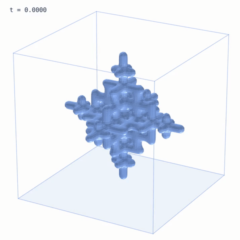
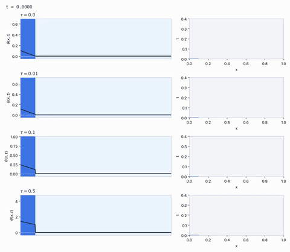

# Stefan-Problem-Enthalpy-Method

Enthalpy method solver for the Stefan problem in 1D, 2D and 3D, with some animations of the phase evolution. Also includes a numerical exploration of an extension to Cattaneo-type (hyperbolic) heat conduction, tested against a travelling wave solution.

<p align="center">
  
  
</p>

## The problem

The Stefan problem describes heat conduction in a material that changes phase (here, ice and water), where the interface between the phases is a free boundary that moves with the solution. Instead of tracking the front, the enthalpy method writes the problem in terms of the enthalpy $H$ (sensible plus latent heat),

$$
H_t = \Delta \beta(H),
$$

where $\beta(H)$ is the Kirchhoff potential. The phases are recovered from $H$, and the front is the level set where the liquid fraction is $1/2$. This allows the front to change topology (merge, split, disappear) without any special treatment.

## What is implemented

- **Fickian (classical) case.** Explicit finite volume scheme on a uniform mesh in $d = 1, 2, 3$, with Dirichlet and Neumann boundary conditions through ghost cells, and different conductivity and heat capacity in each phase. The time step is chosen so that the scheme is monotone, and the scheme is conservative (the heat that enters through the boundary is tracked).
- **Cattaneo case.** Fourier's law is replaced by the Cattaneo law $\tau q_t + q = -\nabla u$. The flux lives on the cell faces, the relaxation term is treated implicitly and the transport explicitly; for $\tau = 0$ it is exactly the Fickian scheme. A small $O(h)$ numerical viscosity is added (see below).
- **Exact solutions** for testing: the Neumann solution (Fickian case) and a travelling wave with a melting front (Cattaneo case).
- **Visualization** of the phase evolution from dendritic initial data: layers of ice and water in 1D, a snowflake in 2D and a cubic dendrite in 3D.

The notebooks contain a short description of each scheme. The mathematical details and references will be in the document in `Doc/`.

## Results

- **Fickian case.** Against the Neumann solution, the error in the temperature decreases with the mesh size (in $L^1$, from $2.8\times10^{-3}$ with $N = 200$ to $1.5\times10^{-4}$ with $N = 1600$), and the energy balance holds up to rounding error.
- **Cattaneo case.** For $\tau > 0$ the temperature is discontinuous at the front. The direct extension of the scheme is stable and conservative, but it does not converge to the travelling wave: it produces oscillations behind the front that do not decrease when the mesh is refined, and they get worse as $\tau$ grows. With the $O(h)$ numerical viscosity the scheme converges at first order for all the values of $\tau$ tested.

<p align="center">
  
</p>
<p align="center"><em>Travelling wave for different values of τ (numerical solution vs. exact solution, dashed).</em></p>

## Repository structure

```
├── enthalpy.py          # Material, beta, conversions, Laplacian, boundary conditions, EnthalpySolver
├── cattaneo.py          # CattaneoSolver
├── exact_solutions.py   # Neumann solution, travelling wave, cell averages
├── visualization.py     # colors, snapshots, dendritic initial data, animations
├── Fickian.ipynb        # validation against the Neumann solution + animations in 1D, 2D and 3D
├── Cattaneo.ipynb       # validation against the travelling wave + animation for different τ
├── Animations/          # gifs
└── Doc/                 # document with the mathematical details
```

## How to run

The code only needs `numpy`, `scipy`, `matplotlib` and `scikit-image`. The notebooks import the `.py` files, so they have to be in the same folder. The notebooks in the repository are already executed.

To run them in Google Colab, add a first cell with

```
!git clone https://github.com/cesaramr314/Stefan-Problem-Enthalpy-Method.git
%cd Stefan-Problem-Enthalpy-Method
```

Each notebook takes a few minutes (the 3D simulation is the slowest part).
